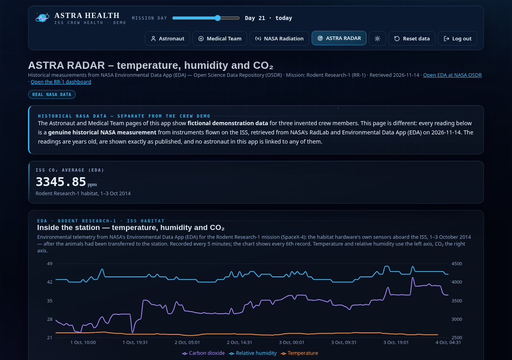
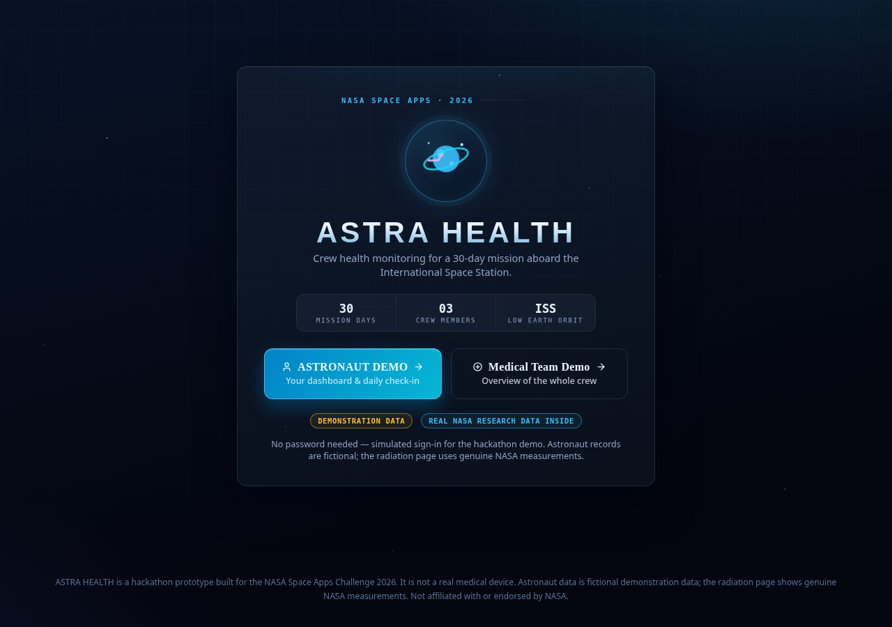
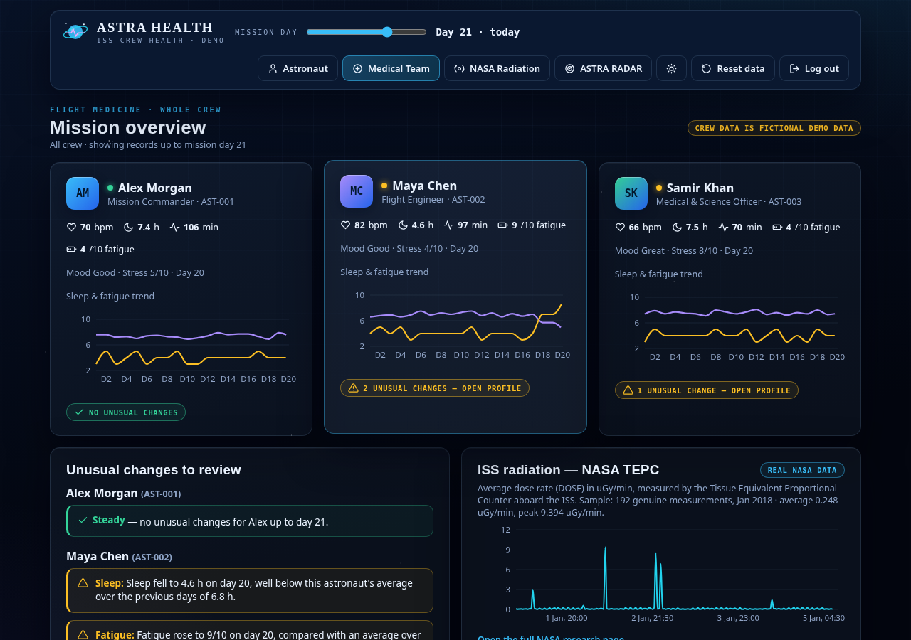
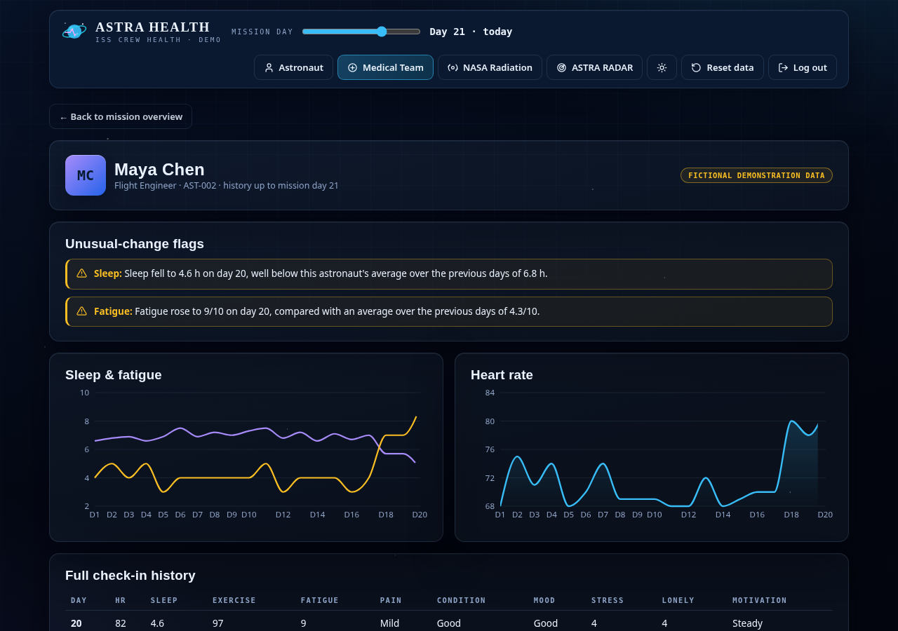
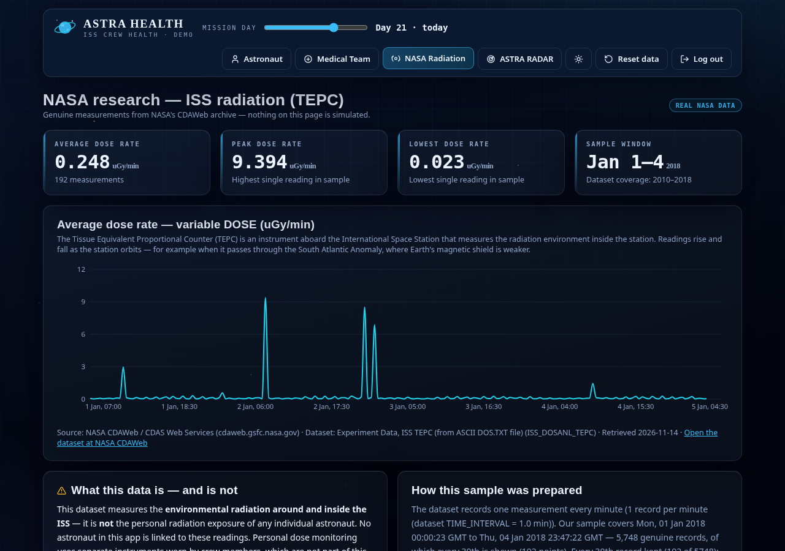
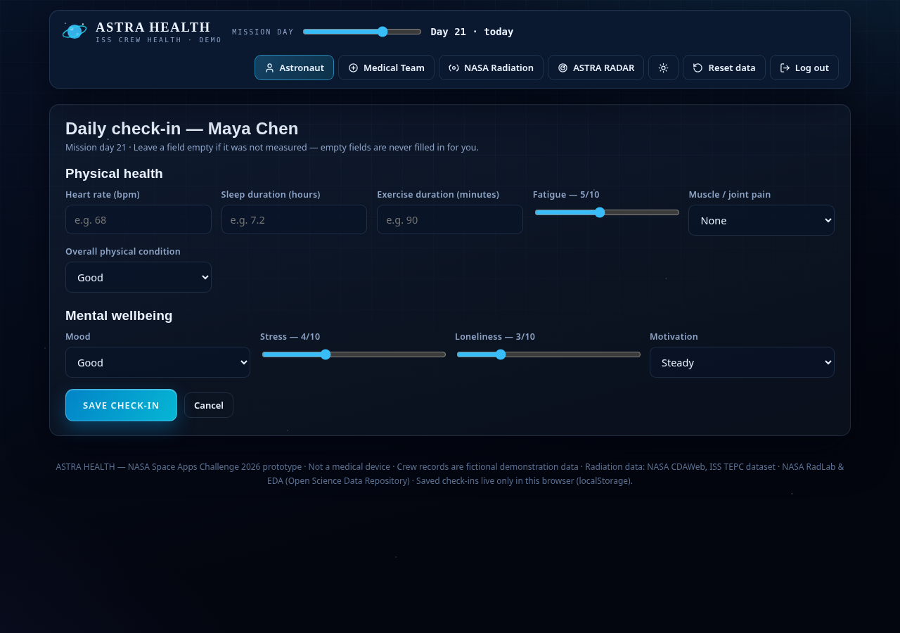
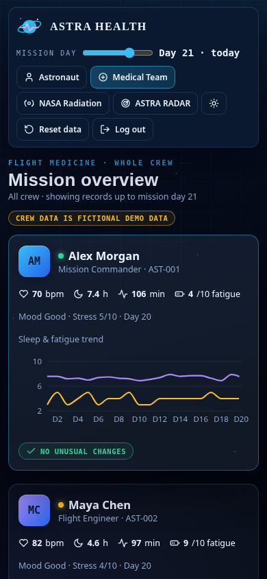

# ASTRA HEALTH — Astronaut Health Monitoring

**Crew health monitoring for a 30-day mission aboard the International Space Station.**

Built by **Team A.I.M.** for the **NASA Space Apps Challenge 2026** —
challenge: *"Create Health Monitoring Software for Astronauts on Space Missions"*
(UMT, Lahore · 14–15 November 2026)

### ▶ Live demo: https://abdullaharshad-bit.github.io/astra-health/
### ▶ Code: https://github.com/AbdullahArshad-bit/astra-health

> No password needed — the login page has two demo buttons. Try it in 2 minutes
> with the [guided demo flow](#-the-2-minute-demo--start-here-judges) below.

> **Honesty first:** this is a hackathon prototype, **not a real medical device**.
> The three astronauts are fictional and their health records are demonstration
> data. The radiation and environment pages use **genuine NASA measurements**,
> labelled as such everywhere they appear. ASTRA HEALTH is not affiliated with
> or endorsed by NASA.

---

## The problem

On a long mission, crew health changes slowly before it changes suddenly.
Sleep shortens a little each night. Fatigue creeps up. Stress builds quietly.
A flight surgeon watching raw numbers for a whole crew can miss the moment a
small change becomes a pattern — and in space, there is no hospital next door.

What the medical team needs is not more numbers. It needs a system that knows
each astronaut's **own normal**, watches it every day, and raises a plain-word
flag the moment someone drifts away from it.

## Our solution

ASTRA HEALTH follows a fictional three-person crew through a 30-day ISS
mission, day by day:

- **Astronauts** record a short daily check-in — physical health and mental
  wellbeing in under a minute.
- **The medical team** sees the whole crew on one overview. Anyone drifting
  from their personal baseline gets a **flag that explains itself** in plain
  words ("Sleep fell to 4.6 h on day 20, well below this astronaut's average
  of 6.8 h") — never a diagnosis, always a reason to look closer.
- **Two research pages** put the crew in their real environment: genuine NASA
  radiation measurements from instruments aboard the ISS, and real station
  habitat telemetry (temperature, humidity, CO₂).


*ASTRA RADAR: real ISS habitat telemetry from NASA's EDA — temperature,
humidity and CO₂ recorded by the Rodent Research-1 habitat sensors.*

---

## 📸 The app at a glance

| | |
|---|---|
|  |  |
| **Login** — two demo buttons, no password. Mission-patch hero, demo-data labels up front. | **Mission overview** — the whole crew at a glance: latest readings, sleep/fatigue trends, flag chips. |
|  |  |
| **Astronaut profile** — Maya Chen's two flags, explained; full trends and history. | **NASA Radiation** — genuine ISS TEPC dose-rate data from NASA CDAWeb, with sources. |
|  |  |
| **Daily check-in** — physical + wellbeing fields. Empty fields stay empty; nothing is invented. | **Mobile** — the same overview on a phone. Light and dark modes both supported. |

---

## 🎬 The 2-minute demo — start here, judges

1. **Open the live demo** and click **Medical Team Demo**.
   You see all three astronauts. Note the flag chips: Maya Chen has **2**,
   Samir Khan has **1**, Alex Morgan has **none**.
2. **Click Maya Chen's card.** Read her flags: her sleep fell to 4.6 hours and
   her fatigue rose to 9/10 on day 20 — each compared with *her own* average
   over the previous days. Scroll for her full history.
3. **Go back, click Astronaut** (top bar) and press **Daily Check-in**.
   Enter any values and save. Your record appears in the history marked
   *"Your check-in"* — and it is still there after a refresh.
4. **Drag the Mission Day slider** (top bar, Day 1–30) to travel back and
   watch the crew's records change.
5. **Click NASA Radiation.** This is real data: 192 genuine ISS TEPC
   dose-rate measurements from NASA CDAWeb (January 2018), with the dataset
   ID, units and source link on the page.
6. **Click ASTRA RADAR.** Real station environment telemetry from NASA's
   EDA — temperature, humidity and CO₂ aboard the ISS. Read the banner:
   historical NASA data, kept strictly separate from the fictional crew demo.
7. **Reset data** (top bar) restores the demo to its starting state.

## 🎤 Presenting it — a 90-second script

> "Long missions fail slowly first. Sleep drops, fatigue rises, stress builds —
> and raw numbers hide it.
>
> ASTRA HEALTH gives every astronaut a **personal baseline**. Each day, the
> crew member completes a one-minute check-in — heart rate, sleep, exercise,
> fatigue, mood, stress. The medical team sees the whole crew on one screen.
> When someone drifts from *their own* normal, the app raises a flag **and
> explains it in plain words**. It never diagnoses — it tells a human where
> to look.
>
> And because crew health does not happen in a vacuum, we connected the app
> to the station itself: two pages of **genuine NASA data** — radiation
> measured aboard the ISS by the TEPC instrument, and real
> habitat temperature, humidity and CO₂ telemetry. The fictional demo and the
> real NASA data are labelled and kept separate, everywhere.
>
> It is a prototype — no server, no real patients — but the loop is complete:
> check in, compare, flag, explain, review. That loop is what scales to a
> real mission."

**Likely judge questions, answered honestly:**

- *"Is any of this real medical data?"* — No. The crew is fictional and
  labelled as such. The radiation and environment data is genuinely NASA's,
  with dataset IDs, units and retrieval notes in
  [SCIENTIFIC_REFERENCES.md](SCIENTIFIC_REFERENCES.md).
- *"How do the flags work?"* — Each astronaut's latest day is compared with
  their own average over all previous days. Cross a clear threshold and a
  flag is raised with the numbers inside the explanation. Simple rules,
  deliberately — they are demonstration rules, not clinical criteria.
- *"Why personal baselines instead of fixed limits?"* — Because "normal" is
  personal. A heart rate that is fine for one astronaut is a change for
  another. Fixed limits miss drift; personal baselines catch it.

---

## How it works

```
Astronaut ── daily check-in ──▶ local store (browser localStorage)
                                      │
                                      ▼
                          records per astronaut, per day
                                      │
                    ┌─────────────────┴─────────────────┐
                    ▼                                   ▼
        Personal-baseline flag engine        Dashboards & profiles
        latest day vs own average             trends · history · KPIs
        over all previous days                (astronaut + medical team)
                    │
                    ▼
        Plain-word flags — "Sleep fell to 4.6 h on day 20,
        well below this astronaut's average of 6.8 h"

Real NASA data (offline-verified extracts, shipped with the app):
  NASA CDAWeb TEPC ──▶ NASA Radiation page
  NASA EDA (OSDR) ──▶ ASTRA RADAR page
```

- **Check-ins** are saved in the browser (localStorage), persist across
  refreshes, and re-saving the same day replaces that day's record instead
  of duplicating it. **Empty fields stay empty** — the app never invents a
  value that was not measured.
- **The fictional crew:** Alex Morgan (AST-001, Mission Commander),
  Maya Chen (AST-002, Flight Engineer), Samir Khan (AST-003, Medical &
  Science Officer). "Today" in the simulation is **mission day 21**; demo
  records cover days 1–20. Two honest story beats are built in so the flags
  have something real to show: Maya's sleep falls and fatigue rises late in
  week 3, and Samir's stress rises.
- **Mission day selector (1–30)** filters every view to records up to the
  selected day.

## Real NASA data used

Every reading on the two research pages is a genuine NASA measurement,
retrieved on 2026-11-14 and shipped as a verified extract. Nothing was
averaged, interpolated or invented; thinning (keeping every Nth record for
chart size) is documented per dataset in
[src/data/RADLAB-NOTES.md](src/data/RADLAB-NOTES.md) and
[src/data/TEPC-NOTES.md](src/data/TEPC-NOTES.md).

| Page | Source | Instrument / dataset | What it shows | Window & samples |
|---|---|---|---|---|
| NASA Radiation | NASA CDAWeb | ISS TEPC (`ISS_DOSANL_TEPC`), variable `DOSE` | Average dose rate inside the ISS, **uGy/min** | Jan 2018 · 192 points (of 5,748 real 1-min records) · avg 0.248, peak 9.394 |
| ASTRA RADAR | NASA EDA (OSDR) | Rodent Research-1 habitat sensors (SpaceX-4) | Temperature °C, relative humidity %, CO₂ ppm aboard the ISS | 1–3 Oct 2014 · 144 charted (of 864 genuine 5-min records) · 21.8–23.1 °C, RH 42–50 %, CO₂ 2,627–4,131 ppm |
| ASTRA RADAR (sample table) | NASA RadLab (OSDR) | DosTel1 (DOSTEL telescope, Columbus module) | Absorbed dose rate, **µGy/hour**, ~100 s cadence | 1 Jan 2018 · sample table at the foot of the page shows every 16th of the 226-point extract (of 904 retrieved) · avg 27.34, peak 484.605 (South Atlantic Anomaly passes) |

*Change note (15 Nov 2026): the ASTRA RADAR page originally also charted the
RadLab DosTel1 and IV-TEPC series. For the final presentation the team
simplified the page to the EDA environment view; the verified RadLab extract
(all 64 IV-TEPC daily values included) remains in the project at
`src/data/radlab.json`, with its method in `src/data/RADLAB-NOTES.md`, and a
DosTel1 sample table still appears at the foot of the page.*

Source links: [NASA CDAWeb TEPC dataset](https://cdaweb.gsfc.nasa.gov/cgi-bin/eval2.cgi?dataset=ISS_DOSANL_TEPC&index=sp_phys) ·
[NASA RadLab](https://visualization.osdr.nasa.gov/radlab/) ·
[RadLab Data API](https://visualization.osdr.nasa.gov/radlab/gui/data-api/) ·
[NASA EDA](https://visualization.osdr.nasa.gov/eda/) ·
[RR-1 dashboard](https://visualization.osdr.nasa.gov/eda/dashboard_RR-1)

**What this data is — and is not:** these instruments measure the
*environment around and inside* the station. They are **not** any individual
astronaut's personal dose, they are **historical** (years old, shown exactly
as published), and they are **not a live feed**. The EDA series comes from
one experiment habitat's sensors, not whole-station life-support monitoring.
The app says all of this on the pages themselves.

---

## Testing — everything verified, nothing assumed

**43 automated tests, all passing** (re-run in full on 2026-11-15, including
after the ASTRA RADAR simplification), plus real-browser verification:

| Layer | What runs | Result |
|---|---|---|
| Logic tests (34) | Seed data integrity & determinism · flag engine (Maya → Sleep + Fatigue flags, Samir → Stress flag, Alex → none) · localStorage store (persistence, same-day replace, empty-stays-empty, reset, day filter) · TEPC, RadLab and EDA data (counts, units, sane ranges, ascending timestamps) | ✅ 34/34 |
| UI walkthrough tests (9) | Real clicks through the app: both demo logins, dashboards, profile with flags, check-in save + refresh persistence, day selector, NASA Radiation page, ASTRA RADAR page, reset | ✅ 9/9 |
| Build & lint | `tsc -b` type-check, production build, lint | ✅ clean (0 errors) |
| Real browser (Playwright/Chromium) | Screenshots of every page — desktop, mobile, light & dark — visually inspected | ✅ all pages render, no overflow, solid header |
| Live deployment | The published GitHub Pages site fetched and checked directly | ✅ HTTP 200, current bundle |

Full detail: [TESTING_REPORT.md](TESTING_REPORT.md)

## Tech stack

React 19 + TypeScript + Vite · Recharts for charts · plain CSS
(mission-control design system: Space Grotesk / Inter / JetBrains Mono) ·
Vitest + Testing Library + Playwright for tests · hosted on GitHub Pages.
No backend by design — this MVP's persistence is browser localStorage, as
specified in the project brief.

## Run it locally

```bash
npm install     # once
npm run dev     # dev server (default http://localhost:5173)
npm test        # 34 logic tests + 9 UI walkthrough tests
npm run build   # type-check + production build into dist/
```

## Project structure

```
src/
  pages/       Login · AstronautDashboard · CheckInForm · MedicalDashboard
               AstronautProfile · Research (NASA Radiation) · Radar (ASTRA RADAR)
  components/  Logo · icons · shared UI · TepcChart · RadarChart
  data/        seed.ts (fictional crew history) · flags.ts (flag engine)
               store.ts (localStorage) · tepc.json · radlab.json · eda.json
               TEPC-NOTES.md · RADLAB-NOTES.md (data provenance)
test/          logic.test.ts · ui.test.tsx · shots.mjs + shots/ (screenshots)
```

## Team A.I.M.

| Member | Role |
|---|---|
| Usama Farooq | Team lead · Biomedical / Health Lead — health indicators, alert rules, project direction |
| Abdullah Arshad | Development — app design, build, data integration, testing, deployment |
| Habiba Kanwal | Team member — research & datasets |
| Amna Khalid | Team member |
| Haseeba Imtiaz | Team member |

## Limitations (honest)

- Prototype only: no real authentication, no server, no real medical data;
  check-ins live in one browser and do not sync between devices.
- Flag thresholds are simple demonstration rules, not clinical criteria,
  and the app never diagnoses anything.
- The NASA extracts are small verified windows of much larger datasets
  (TEPC coverage ends 2018-04-11); they are historical, not live.
- Charts need the real-browser screenshots for visual proof; the DOM tests
  verify data and behaviour, not pixels.

## Where this could go next

- A real backend so a crew's devices sync to one medical overview.
- Wearable/sensor ingestion instead of manual check-ins.
- Clinician-reviewed thresholds and trend detection over weeks, not days.
- Live RadLab/EDA feeds, with the same strict labelling of what is real,
  what is historical, and what is simulated.

## References & documents

- [SCIENTIFIC_REFERENCES.md](SCIENTIFIC_REFERENCES.md) — every dataset's
  source, method, units and limits
- [TESTING_REPORT.md](TESTING_REPORT.md) — the full verification record
- [src/data/TEPC-NOTES.md](src/data/TEPC-NOTES.md) ·
  [src/data/RADLAB-NOTES.md](src/data/RADLAB-NOTES.md) — retrieval provenance

**AI disclosure:** built with AI-assisted coding, as Space Apps requires us
to state. Astronaut records are fictional demonstration data; all NASA data
is genuine with the provenance above.

*ASTRA HEALTH — NASA Space Apps Challenge 2026 prototype. Not a medical
device. Not affiliated with or endorsed by NASA.*
